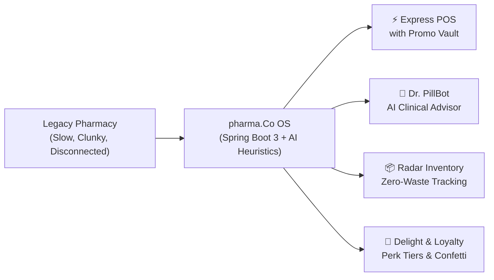
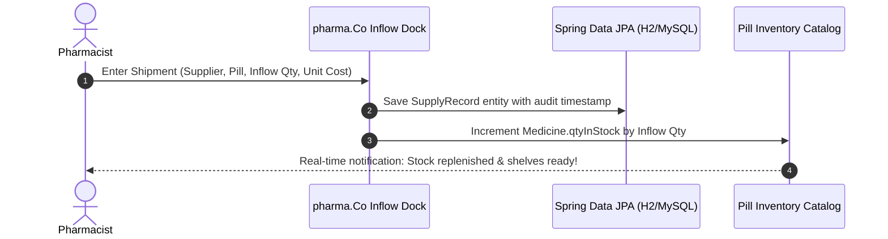
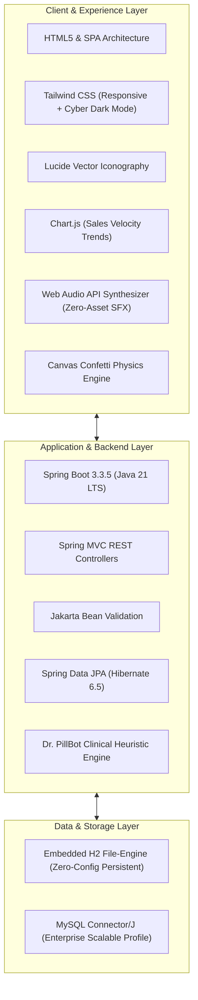
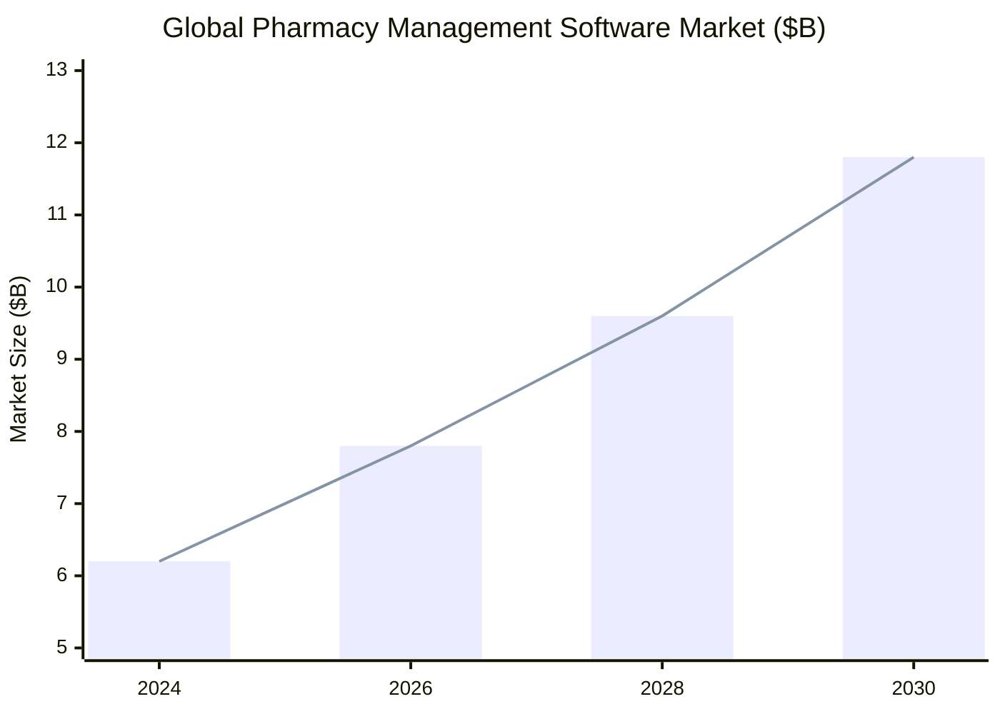

# 💊✨ pharma.Co — Investor & Product Pitch Deck
> **The Next-Gen Smart Apothecary & Wellness Operating System**  
> *Transforming the retail pharmacy from a cold pill counter into an intelligent, delight-driven health hub.*

---

## 📑 Pitch Deck Executive Overview



---

## 🎯 Slide 1: Title & Vision

# pharma.Co 💊
### *"Your Friendly Neighbourhood Wellness Apothecary & Next-Gen Dispenser OS"*

* **Category**: Healthcare Technology / Pharmacy Management Systems (PMS) & POS
* **Core Philosophy**: Merging enterprise-grade transactional reliability with consumer delight, interactive AI health guidance, and zero-configuration deployment.
* **Target Audience**: Independent retail pharmacies, compounding apothecaries, wellness clinics, university campus health centers.
* **Live Demo URL**: [http://localhost:8080](http://localhost:8080)
* **Open Source Repository**: [github.com/kavyajaiswal007/Pharma.co](https://github.com/kavyajaiswal007/Pharma.co)

---

## ⚠️ Slide 2: The Problem — The Broken Pharmacy Experience

Traditional pharmacy software is notorious for:

1. **Stone-Age User Experience**: Most community pharmacies run 15-year-old desktop software (Java Swing, Windows XP interfaces) with steep learning curves, cluttered screens, and painful training times for new staff.
2. **Silent Stockouts & Wasteful Expirations**: Expired drugs sit unnoticed on shelves until discovered by chance, while critical life-saving medications run out with zero automated early-warning mechanisms.
3. **Impersonal, Cold Transactions**: Patients are treated as invoice lines; there is zero loyalty engagement, no personalized dosage tips, and no preventive guidance.
4. **Heavy Setup & Fragile Infrastructure**: Legacy solutions require manual database installations, network proxy configurations, and costly on-premise hardware engineers.

> [!WARNING]
> Over **18% of community pharmacy revenue** is lost annually to expired medicine shrinkage and inventory mismanagement, while customer retention drops by 35% when checkout takes longer than 3 minutes.

---

## 💡 Slide 3: The Solution — pharma.Co

**pharma.Co** reimagines pharmacy software from first principles:

* **Instant Zero-Config Boot**: Powered by **Spring Boot 3.3** with an embedded, zero-setup persistent H2 engine. Unpack and run with a single command.
* **Express POS Terminal**: Lightning-fast medicine search, live stock-on-hand validation, line-by-line cart manifest, and instant balance calculations.
* **Dr. PillBot AI Clinical Lab**: An interactive patient guidance heuristics engine that suggests supplement pairings, flag interactions, and answers common medication questions in seconds.
* **Active Expiration & Stock Radar**: 60-day predictive expiration tracking and real-time low-stock threshold triggers.
* **Micro-Delight Experience**: Web Audio synthesizer sound effects, confetti animations on checkout, customized "Prescription for Happiness" advice on receipts, and Cyber Dark Mode.

---

## ⚡ Slide 4: Feature Deep-Dive — Express POS & Billing

The core revenue engine of pharma.Co is built for speed, accuracy, and customer delight:

| Capability | What It Does | Business Value |
| :--- | :--- | :--- |
| **Instant SKU & Formulation Lookup** | Real-time dropdown and search with stock levels and price pre-loaded. | Prevents overselling and eliminates manual price checks. |
| **Live Cart Boundary Validation** | Prevents adding more units than physically on shelf. | Eliminates checkout discrepancies and inventory drift. |
| **🎟️ Magic Promo Vault** | Integrated discount engine supporting coupon codes: `MAGICPILL` (-15%), `STUDENTREVIVE` (-10%), `HAPPYPILL` (-Rs.100), `IMMUNITYBOOST` (-20%). | Boosts customer satisfaction, increases basket size, and supports promotional campaigns. |
| **Dynamic Cash & Change Calculator** | Real-time balance computation with visual warnings if cash is short. | Eliminates cashier math errors during rush hours. |
| **Multi-Sensory Checkout** | Web Audio API *ka-ching* sound + canvas confetti celebration. | Memorable customer experience that turns mundane retail into delight. |
| **Thermal Receipt & PDF Invoice** | Clean receipt with invoice ID, itemized rates, cashier name, barcode simulation, and wellness quotes. | Print-ready for both standard 80mm thermal receipt printers and desktop A4 printers. |

---

## 🤖 Slide 5: Feature Deep-Dive — Dr. PillBot AI Clinical Lab

**Dr. PillBot** is pharma.Co’s built-in intelligent clinical advisor:

* **Synergy Stacking**: Recommends high-absorption pairings (e.g., Vitamin D3 with healthy fats, Iron with Vitamin C).
* **Antibiotic Stewardship**: Automatic reminders on finishing complete antibiotic cycles to fight resistant superbugs.
* **Sleep & Energy Protocols**: Natural, science-backed lifestyle recommendations (Magnesium Glycinate timing, circadian sleep temperature, morning B-Complex absorption).
* **Patient Interaction Warning**: Clear cautions against drug-supplement contraindications.
* **Prompt Chips**: One-click consultation for headaches, immunity, vitamins, and energy.

> [!TIP]
> Dr. PillBot bridges the gap between pharmacist dispensing and patient wellness education, driving high-margin supplement sales and patient trust.

---

## 📦 Slide 6: Supply Chain & Inflow Restock Dock

Managing vendor relationships and shelf availability seamlessly:



* **Automated Catalog Synchronization**: Inflow commitments instantly increment shelf quantities with zero manual inventory edits.
* **Supplier Directory**: Tracks vendor contacts, emails, and reliability ratings (e.g., `4.9 ★`).
* **Expiring Soon Radar**: Automatic color-coded triage highlighting batches expiring within 60 days.

---

## 🛠️ Slide 7: The Complete Technology Stack

pharma.Co is built with modern, enterprise-proven technologies designed for speed, resilience, and maintainability:



### Detailed Stack Breakdown:

1. **Backend / API**:
   * **Language**: Java 21 LTS (Records, Pattern Matching, Sealed types, Virtual Threads ready).
   * **Framework**: Spring Boot 3.3.5 with Spring Web MVC.
   * **Persistence**: Spring Data JPA with Hibernate ORM 6.5.
   * **Security & Auth**: Role-Based Access Control (Admin vs. Apothecary Staff) with password reset workflows.

2. **Database**:
   * **Default Engine**: Embedded **H2 Database** configured with file persistence (`./data/pharmaco`). Zero external database installation needed!
   * **Enterprise Engine**: Native **MySQL Connector/J 9.x** support via profile switching.

3. **Frontend / UI**:
   * **CSS Framework**: Tailwind CSS with custom theme extensions and dark mode classes.
   * **Visual Analytics**: Chart.js for daily sales trend curves and velocity forecasting.
   * **Audio / FX**: Native browser Web Audio API synthesizer for sound effects (no external `.mp3` files needed).
   * **Print Engine**: Dedicated `@media print` CSS stylesheet formatting bills for 80mm thermal receipt printers.

---

## 📈 Slide 8: Market Opportunity & Target Market

The global pharmacy management system market is projected to reach **\$11.8 Billion by 2030** (CAGR 10.4%).



### Key Target Segments:
* **Independent & Community Pharmacies** (over 25,000 in North America and 800,000 globally seeking cloud-modern software).
* **Compounding & Bio-Hacking Apothecaries** needing wellness-first patient education.
* **Campus & University Dispensaries** requiring rapid student checkouts and promo code flexibility.
* **Clinics & Urgent Care Centers** with on-site dispensing rooms.

---

## 💰 Slide 9: Business & Monetization Model

pharma.Co utilizes a high-margin **Hybrid SaaS + Transaction** model:

```text
┌──────────────────────────────┬──────────────────────────────┬──────────────────────────────┐
│       STARTER APOTHECARY     │       PRO DISPENSARY         │      ENTERPRISE CHAIN        │
│          $49 / month         │         $129 / month         │         $299+ / month        │
├──────────────────────────────┼──────────────────────────────┼──────────────────────────────┤
│ • 1 Terminal POS             │ • Unlimited POS Terminals    │ • Multi-branch Sync          │
│ • Full Pill Catalog & CRUD   │ • Dr. PillBot AI Clinical    │ • Centralized Warehouse Inflow│
│ • File H2 Storage            │ • Magic Promo Vault          │ • Custom ERP / EDI Connect   │
│ • Printable Thermal Receipts │ • Low Stock & Expiry Radar   │ • Dedicated 24/7 SLA Support │
│ • Basic Sales Reports        │ • Customer Loyalty Tiers     │ • Dedicated Cloud DB Cluster │
└──────────────────────────────┴──────────────────────────────┴──────────────────────────────┘
```

### Additional Revenue Streams:
* **Supplier Sponsored Insights**: Anonymized restocking trends for wholesale pharma distributors.
* **Patient Engagement Add-ons**: Automated WhatsApp / SMS prescription refills & receipt dispatching.

---

## 🏆 Slide 10: Competitive Advantage (The Moat)

| Feature / Metric | Legacy PMS (Windows/JavaFX) | Generic Retail POS (Square/Shopify) | **pharma.Co 💊** |
| :--- | :--- | :--- | :--- |
| **Setup Time** | 3 - 5 days with technician | 1 - 2 hours | **< 3 minutes (Zero-Config)** |
| **Pharma Expiry Radar** | Manual reports | None (Generic retail) | **Automated 60-day visual radar** |
| **Clinical Patient AI** | Non-existent | None | **Dr. PillBot Integrated AI** |
| **Modern UX & Dark Mode** | Cluttered Windows 98 look | Sleek retail look | **Playful Apothecary Cyber UX** |
| **Hardware Independence** | Locked to specific PCs | Tablet/Web | **Any device with modern browser** |
| **Interactive Billing** | Slow tabular entry | Fast but non-clinical | **Express POS + Promo Vault + SFX** |

---

## 🗺️ Slide 11: Product Roadmap

* **Phase 1 (Completed ✅)**:
  * Full Spring Boot 3 conversion with Spring Data JPA.
  * Express POS with Magic Promo Vault and dynamic checkout.
  * Embedded persistent H2 database with auto-seeding.
  * Dr. PillBot AI Clinical Lab heuristics.
  * Web Audio sound effects, Confetti, and Cyber Dark Mode.
  * Thermal receipt printing and supplier inflow automation.
* **Phase 2 (Q1 2027)**:
  * WhatsApp & SMS Cloud Receipt Dispatching via Twilio.
  * Barcode & QR Code physical scanner integration (HID Keyboard Wedge).
  * Drug-Drug Interaction (DDI) database integration with open FDA APIs.
* **Phase 3 (Q2 2027)**:
  * Multi-branch inventory sync via WebSockets / Kafka.
  * Patient mobile portal with prescription refill requests.
  * Offline-First PWA (Progressive Web App) support.

---

## 🤝 Slide 12: The Team & Call to Action

**pharma.Co** is built with passion, precision, and a vision to make pharmacy care both efficient and joyful.

* **Live Demo**: Open **[http://localhost:8080](http://localhost:8080)** on your local machine.
* **Code Repository**: Inspect and star the code at **[github.com/kavyajaiswal007/Pharma.co](https://github.com/kavyajaiswal007/Pharma.co)**.
* **Default Credentials**:
  * Admin Access: `admin` / `123`
  * Dispensary Staff: `isuru` / `456`

> *"Empowering Pharmacies. Enriching Patient Lives. Welcome to pharma.Co."* 💊✨
